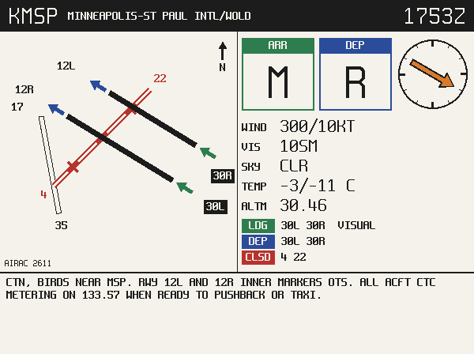
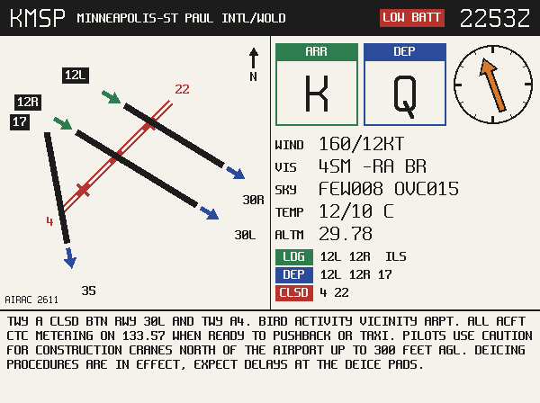

# Inkplate ATIS

Shows the current D-ATIS, weather and runway configuration for an airport
(KMSP by default) on a Soldered Inkplate 6COLOR.

| Live ATIS                     | South flow sample                                    |
| ----------------------------- | ---------------------------------------------------- |
|      |          |

Both images come from the simulator (`make preview`), which draws exactly what the board does.

```
atis.info ──► Inkplate firmware ──► e-paper panel
                    ▲
   runway data and fonts baked in at build time
```

The board is standalone. It wakes, fetches the ATIS from atis.info over HTTPS,
works out which runways are landing, departing and closed, draws the 600×448
screen in the panel's seven inks, and goes back to deep sleep. The panel is
only refreshed when the broadcast changed.

| Folder      | What it is                                                             |
| ----------- | ---------------------------------------------------------------------- |
| `firmware/` | The Arduino sketch. Parsing and drawing live in `inkplate_atis/src/`.  |
| `sim/`      | Builds that same `src/` on your computer for tests and PNG previews.   |
| `tools/`    | Bun scripts that generate the runway and font tables in `src/`.        |

## Firmware

Copy `firmware/inkplate_atis/config.example.h` to `config.h` and set the WiFi
credentials. Then, with Nix, the dev shell provides the whole toolchain:

```bash
nix develop
make setup    # once: installs the Inkplate board package and library into .arduino/
make flash    # compile and upload; PORT=/dev/cu.usbserial-XXXX to pick a port
make monitor  # serial log
```

`make test` and `make preview` run the simulator described below.

Without Nix:

1. In the Arduino IDE, add the Inkplate board package
   (`https://github.com/SolderedElectronics/Dasduino-Board-Definitions-for-Arduino-IDE/raw/master/package_Dasduino_Boards_index.json`),
   install the **InkplateLibrary** library, and select **Soldered Inkplate 6COLOR**.
2. Open `firmware/inkplate_atis/inkplate_atis.ino` and upload. If the upload
   stops with "chip stopped responding", set Tools → Upload Speed to 115200.

On Apple Silicon without Rosetta the board package's bundled `esptool` cannot
run; `make setup` replaces it with the dev shell's native one.

Or with arduino-cli:

```bash
arduino-cli compile --fqbn Inkplate_Boards:esp32:Inkplate6COLOR:UploadSpeed=115200 firmware/inkplate_atis
arduino-cli upload  --fqbn Inkplate_Boards:esp32:Inkplate6COLOR:UploadSpeed=115200 -p /dev/cu.usbserial-XXXX firmware/inkplate_atis
```

Behaviour:

- Sleeps for `REFRESH_SECONDS` (5 minutes), then checks again. An unchanged
  broadcast costs a few seconds of WiFi and no panel refresh.
- The wake button forces an immediate full redraw.
- If WiFi or atis.info is unreachable it keeps the last broadcast on screen,
  retries every minute, and shows the reason after three failures in a row.
- Shows a LOW BATT flag below 3.5 V.
- By default the TLS connection is encrypted but atis.info's certificate is not
  verified. Set `ATIS_ROOT_CA` in `config.h` to pin a root certificate.

## Preview and tests

`sim/` compiles the firmware's parser and renderer with your computer's C++
compiler, so the output is exactly what the board draws.

```bash
cd sim
make test                                # parser tests
make preview                             # live ATIS -> ../preview.png
make preview ATIS=samples/south-flow.json
```

`ATIS` is any saved `https://atis.info/api/{ICAO}` response.

## Runway data and fonts

The runway layout in `firmware/inkplate_atis/src/airport_data.cpp` was
extracted from AIRAC 2611. After a new cycle, or for another airport,
regenerate it and reflash:

```bash
cd tools
bun install
bun run extract KMSP ~/Documents/SimToolkitPro/navdata.s3db
```

`bun run fonts` regenerates `fonts.cpp` from the BDF files in `tools/fonts/`.

## Reading the display

- Solid black runways are in use, outlined ones are idle, red ones with crosses are closed.
- Green arrows show landing direction, blue arrows departure direction.
- The runways sit inside a compass rose, north up. The orange arrow on its rim
  marks where the wind comes from and points the way it blows, so it lines up
  with the runways in use. Calm and variable winds are written in the corner instead.

Fonts are [Spleen](https://github.com/fcambus/spleen) (BSD 2-Clause).
